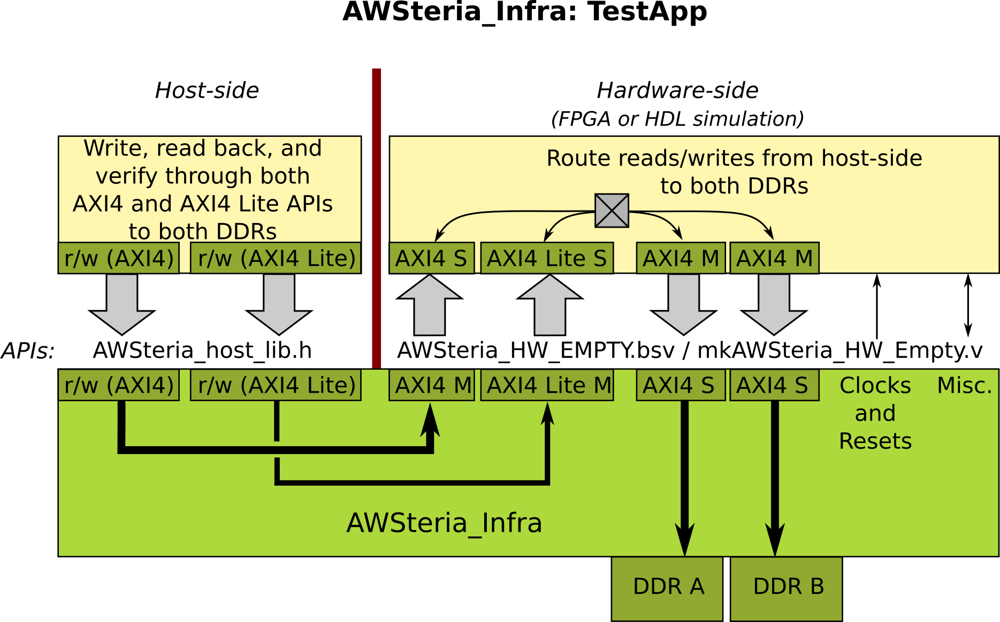

= AWSteria_Infra: How to Build and Run TestApp
Rishiyur S. Nikhil, Bluespec, Inc. (c) 2021-2022
:revnumber: v1.0
:revdate: 2022-07-01
:sectnums:
:toc:
:toclevels: 5
:toc: left
:toc-title: Contents
:description: How to build and run Testapp (host+FPGA) in AWSteria_Infra
:keywords: AWS, F1, Shell, Instance AFI, AMI, DCP, Design Checkpoint, Custom Logic, Garnet
:imagesdir: .
:data-uri:

// ================================================================
// SECTION
== Introduction and Overview

This document describes how to build and run `TestApp`, provided with
AWSteria_Infra, on various platforms:

* HDL Simulation (Verilator and Bluesim)
* Xilinx VCU118 FPGA board attached to a Linux host's PCIe bus
* AWS F1 (in the cloud: Xilinx FPGA board attached to a virtual Linux host)

Please see Section <<Glossary>> at the end of this document for a
glossary of acronyms and terms.

// ================================================================
// SECTION
== Test Application

TestApp is used to test that the infrastructure is working properly on
each platform.  It has a simple HW-side that simply connects both the
AXI4 and AXI4-Lite host-to-HW channels to the DDRs, and a simple
host-side C program that simply exercises these channels, performing
writes and readbacks to the DDRs, self-checking that the readback data
is what was written.

TestApp is useful during porting of AWSteria_Infra to new platforms.

TestApp is also useful as an initial template when developing new applications.

// ----------------------------------------------------------------
// SUBSECTION
=== App source code and intended behavior

`TestApp/Host/main.c` is the host-side source code; it invokes the
host side C API `Include_API/AWSteria_Host_lib.h`.

`TestApp/HW/AWSteria_HW.bsv` is the hardware-side source code, filling
out the "`empty`" module provided in
`Include_API/AWSteria_HW_EMPTY.bsv`.

The hardware side is simple: it connects the host AXI4-Lite interface
to an AXI4-Lite-to-AXI4 adapter which, along with the host AXI4
interface, connects to a 2x2 AXI4 crossbar switch which, in turn,
connects to two AXI4 DDR interfaces.

The host side simply writes data to various addresses in the
hardware-side DDRs, and reads them back to verify the data.  Writes
and reads are performed over both the host AXI4 and AXI4 Lite
interfaces, including writing through one and reading through the
other.  The AXI4 interface is also exercised with large writes and
reads, to exercise AXI4 burst transfers.

The architecture is shown in the following diagram:

// ================================================================
// SECTION
== Building and running with Bluesim or Verilator simulation

* In `TestApp/Host/build_sim` do `make exe_Host_sim` to create the
  host-side executable `exe_Host_sim`.

* In `TestApp/HW/build_Bluesim` do `make all` to create the HW-side
  simulation executable `exe_HW_sim`.
+
or,
+
in `TestApp/HW/build_Verilator` do `make all` to create the HW-side
simulation executable `exe_HW_sim`.

* Run the hardware side executable in one process (e.g., in one
    terminal window) It will await a TCP connection on a TCP port from
    the host side; it will then execute the hardware.

* Run the host side executable in another process (e.g., in another
    terminal window) It will connect using TCP to the hardware side
    and then interact with the hardware side, displaying messages
    about its actions (reading and writing to DDRs on the hardware
    side).

You will have to kill the HW-side process when done (e.g., using
`^C`).  You can restore each build directory to its pristine state
with `make full_clean`.

// ================================================================
// SECTION
== Building and running on Amazon AWS F1

The first section below ("`AWSF1 Prerequisites`") has general
information about AWS, AWS F1 machine instances, AWS Machine Images,
setting up build infrastructure etc.; this is a one-time learning
experience.  Subsequent sections describe the build-and-run flow,
which you will do repeatedly for TestApp and your own apps.

// ----------------------------------------------------------------
// SUBSECTION
=== AWSF1 Prerequisites: aws-fpga (SDK and HDK) and Vivado tool suite

// ----------------------------------------------------------------
// SUBSUBSECTION
==== Setting up machine instances on the AWS cloud for your FPGA work.

You will need to set up an AWS account (at https://aws.amazon.com[] in
your browser).  After you sign in, find the "`EC2`" dashboard page.
Use the "`Launch Machine Instance`" button/selection to create one or
more AMIs (AWS Machine Instance/Image, see Section <<Glossary>> for
more detail) for your FPGA work.  An AMI is a computer in the cloud to
which you can connect using `ssh` just like any other remote computer.

[NOTE]
====
For _building_ your AWSteria_Infra app, the flow is described in this
document assuming you are running on AWS on a standard "`FPGA
Developer AMI`".  This AMI is pre-built with CentOS, installations of
Vivado and Vivado licenses, etc.  You pay for AMI usage, but there is
no extra charge for Vivado.

You can build for AWS on your own computers ("`on premises`") for
free; in this case you are responsible for installing (and paying for)
Vivado, Vivado licenses, etc.  The flow is identical to building on
AWS (up to and including the "`create AFI`" step).

For _running_ your AWSteria_Infra app, of course, you will have to be
on an AWS F1 instance (instance with FPGA).

On AWS, F1 instances have higher rental rates than other instance
types, so one often uses a cheaper non-F1 instance for build steps
(where running Vivado can take several hours), and then just run the
built application on an F1 instance.
====

*2022-06-26: NEEDS UPDATE:* There is a new Launch Instance flow on AWS
that is somewhat simpler than the one described below, but until we
document it, it is worth reading the following because the concepts
are the same.

In your EC2 dashboard, click "`Launch Instance`".  It will take you
through a series of steps (with the step numbers shown below).

* "`Step 1: Choose an Amazon Machine Image (AMI)`": Search for, and
    select the following AMI (or a later version), which is an AMI
    preconfigured with CentOS, Vivado, Vivado licenses, etc.:
+
--

----
    FPGA Developer AMI 1.11.4    (current in June 2022)
    Linux/Unix, CentOS 7.5
----

Note: For _running_ an AFI, actually your instance does not have to be
based on this AMI; you can choose a different one based on Ubuntu or
Debian or other preference. You don't need Vivado, etc., since you're
not building AFIs here, just running them.  However, we recommend
selecting this AMI so that everything works out of the box, including
the AWS-supplied "`XOCL`" and "`XDMA`" drivers that talk to the FPGA
over the PCIe bus.  Use a different AMI only if you're comfortable
tweaking drivers and other tools for your preferred different
environment.

--

* "`Step 2: Choose an Instance Type`": An Instance Type determines CPU
  type (x86, ARM, ...), memory size, etc.

  ** For building AFIs: The `FPGA Developer AMI` annotations say
      "`The vendor recommends using a z1d.2xlarge instance (or larger)
      for the best experience with this product.`", and we suggest
      choosing it:
+
----
    z1d.2xlarge (- ECUs, 8 vCPUs, 4 GHz, -, 64 GiB memory, EBS only)
----
+

  ** For running AFIs: You must select an instance whose name is of
      the form `f1.xxxx`,since these are "`F1`" instances with
      attached FPGA.  We suggest:
+
----
    f1.2xlarge (- ECUs, 8 vCPUs, 2.3 GHz, -, 122 GiB memory, EBS only)
----

* "`Step 3: Configure Instance Details`":  You can skip most selections, except:

    ** Under "`Subnet`", choose a public subnet, such as "`public
         us-west-2b`".  Without this, you will not be able to connect
         to it from the public network using `ssh`.

    ** Under "`Enable termination protection`", click the checkbox for
       "`Protect against accidental termination`".  When you terminate
       an instance, all its resources, including what's on its file
       system are blown away, and you could lose all your work.  This
       choice prompt you to confirm, before termination.

* "`Step 4: Add storage`":

    ** Leave it as is, or increase "`Root volume`" size (e.g., from
    offereg 100 Gib to 128 GiB)

    ** Optional: increase "`EBS (/dev/sdb) volume`" (e.g., from 5 GB
    to 128 GB) and click the "`Delete on Termination`" checkbox.

* "`Step 5: Add Tags`":  Add at least one tag to give the instance a
    name by which you can easily locate it in the listing of all
    instances on the EC2 dashboard.  Click the "`Add Tag`" button,
    which will open up two slots, one for the name of the tag (e.g,
    enter `Name`) and one for the value associated with the tag (e.g.,
    enter `MyName_AFI_Build` or `MyName_AFI_Run`).
+
Click "`Review and launch`"  (it'll skip Skip 6 about security groups and go to Step 7).

* "`Step 7: Review Instance Launch`": it will warn "`Your instance
  configuration is not eligible for the free usage tier`"; that's ok.
+
Click "`Launch:`"

* It will ask you to "`Select an existing key pair or create a new key pair`"
    and offer a drop-down menu of existing key pairs (if any) for your AWS account.
+
--
The first time around (or if you want a new key pair anyway), you can
request it to create one.  Also, on the main EC2 console web page, you
can scroll the left panel looking for "`Network & Security -> Key
Pairs`" and click on that; it will take you to a page listing all Key
Pairs for your account, and also offer a "`Create key pair`" button to
create a new one.`"

When you create a key pair, it will display the created private
key. _Copy it/download it immediately_ since there is no way to
retrieve it after this step (you can always generate a new key pair
later).  Download the created private key to the computer(s) from
which you will be connecting to AWS in the future using `ssh`.
Typically, you download it to the `~/.ssh/` directory of your
computer.  Example:

----
    $ ls -als ~/.ssh/JohnDoe_Key_Pair1.pem 
    4 -r-------- 1 jdoe jdoe 1696 May  7  2020 /home/jdoe/.ssh/JohnDoe_Key_Pair1.pem

    $ file ~/.ssh/JohnDoe_Key_Pair1.pem 
    /home/jdoe/.ssh/JohnDoe_Key_Pair1.pem: PEM RSA private key
----
--

Finally, it will launch the instance and give you an instance Id
(e.g., `i-073d8472a22b6199e`).  You can also see this instance in the
EC2 dashboard listing of all your instances.  If you gave it a `Name`
tag during creation, it will list it with that name.  You can click on
the "`Name`" field in the instance listing and edit it to give it a
name or change its name.  The "`Instance state`" field will say
"`starting`" or "`initializing`" for some time while it spins up (this
can take a few minutes) , and eventually say "`Running`" when it is
ready, after which you can connect to the instance.

// SUBSUBSECTION ----------------
==== Connecting to your AWS instance using `ssh`

To connect to your new instance using `ssh`, go back to the AWS EC2
web page in your browser and bring up the `instances` dashboard, which
will display a line for each of your instances.  Verify that your new
instance is in the "`running`" state (it can take a minute or so after
launch to spin up to this state).  If it is in the "`stopped`" state,
click it's check-box to select/highlight it, select the `Instance
State` drop down menu, and select "`Start instance`".

Select your instance in the check-box, then click on "`Connect`" to
get connection information.  Specifically, you'll see a `Public IPv4
DNS` similar to this:
`ec2-34-222-48-194.us-west-2.compute.amazonaws.com`.

Use SSH to connect, with username `centos`.  The menu may suggest
username `root`, but if you try this it will likely refuse the
connection, for security reasons. Use username `centos` instead.
You'll need the `-i` flag pointing at your private key which you had
downloaded earlier, for authentication.  Example:

----
    $ ssh -i ../.ssh/JohnDoe_Key_Pair1.pem  centos@ec2-34-222-48-194.us-west-2.compute.amazonaws.com
----

On connection, you'll get a banner similar to this:

----
     ___ ___  ___   _     ___  _____   __    _   __  __ ___
    | __| _ \/ __| /_\   |   \| __\ \ / /   /_\ |  \/  |_ _|
    | _||  _/ (_ |/ _ \  | |) | _| \ V /   / _ \| |\/| || |
    |_| |_|  \___/_/ \_\ |___/|___| \_/   /_/ \_\_|  |_|___|
    AMI Version:        1.9.1
    Xilinx Version:     2020.1
    Readme:             /home/centos/src/README.md
    AMI Release Notes:  /home/centos/src/RELEASE_NOTES.md
    GUI/Cluster setup:  https://github.com/aws/aws-fpga/blob/master/developer_resources
    Developer Support:  https://github.com/aws/aws-fpga/blob/master/README.md#developer-support
    Centos Common code: /srv/git/centos-git-common
    Xilinx XRT source:  https://github.com/Xilinx/XRT
----
and you will be at the `bash` shell prompt of a CentOS virtual machine.
You may want to install your favorite utilities if not already present:
----
    $ sudo yum intall tree
    $ sudo yum intall emacs
----
and upload your favorite bash and editor configurations, etc.
and configure git the way you like it:
----
    $ git config --global core.editor /usr/bin/emacs
    $ git config --global user.name   "John Doe"
    $ git config --global user.email  johndoe@email_provider.com
----

and clone of any other git/GitHub repositories you need, upload any
other files you need, etc. (e.g., the Verilog files of your design).
Note, to upload a file, such as foo.tar.gz from a remote machine, you
can "`pull`" it with `scp` as usual from your AWS AMI bash shell, or
"`push`" it with `scp` from the remote machine, e.g.,:

----
    # On remote machine (not the AMI), pushing to AMI
    $ scp -i ../.ssh/JohnDoe_Key_Pair1.pem \
          foo.tar.gz \
          centos@ec2-34-222-48-194.us-west-2.compute.amazonaws.com:~/
----

// SUBSUBSECTION ----------------
==== The `aws-fpga` repository, and HDK and SDK setup

You need a (free) clone of the AWS-supplied `aws-fpga` repository for three reasons:

* When building an AFI, AWSteria_Infra uses resources and scripts from
    the HDK (Hardware Design Kit) in the repo.

* When building the host-side of your design, AWSteria_Infra uses
    resources and scripts from the SDK (Software Design Kit) in the
    repo.

* To run your AFI, you may need to build and install the XDMA driver
    for high-speed communication over PCIe to the FPGA. The resources
    to build the driver are in the repo.

The `aws-fpga` repo is pre-installed on the "`FPGA Developer`" AMI.
If you are building on your own computers (on premises), however,
please clone it from:

****
https://github.com/aws/aws-fpga.git[]
****

On each login to your AMI, perform the following commands to set up
the HDK and SDK,  respectively:

====
    $ cd .../aws-fpga    # clone of aws-fpga repo
    $ source hdk_setup.sh
    $ source sdk_setup.sh
====

(You can automate this in your login scripts.)  This defines
environment variables `AWS_FPGA_REPO_DIR`, `HDK_DIR`, `SDK_DIR` and
more.  The very first time you do this HDK setup it can take several
minutes, since it invokes Vivado to build DDR4 simulation models, etc.

// SUBSUBSECTION ----------------
==== The `cli` AWS command-line interface

During the build and run flows, you will be using various commands
from the bash shell, all of which begin with the meta-command `aws`.
These are available when you have installed the AWS command-line
interface, `cli`.

This is pre-installed if you are using the "`FPGA Developer`" AMI.

If you are building on your own computers (on premises), however,
please install itas described in

****
https://aws.amazon.com/cli/[]
****

// ----------------
// SUBSECTION
=== Building the hardware side

// ----------------
// SUBSUBSECTION
==== Generate/prepare your app RTL

The following commands are performed in the `TestApp/HW/build_AWSF1`
directory (or, provide both targets to a single `make` command):

----
    $ make  compile
    $ make  for_AWSF1_HDK
----

* The `compile` target creates a directory `RTL/` and populates it
    with Verilog RTL generated from the BSV source code by the
    Bluespec `bsc` compiler.

* The `for_AWSF1_HDK` target creates and populates a directory
    `cl_AWSteria_TestApp/` that is ready to run through the aws-fpga
    HDK flow.

// ----------------
// SUBSUBSECTION
==== AWS HDK step to create a DCP

This step is performed on a machine where you have installed the
Amazon AWS aws-fpga repo, in particular its HDK (see Prerequisites
section above). You should have initialized the HDK by sourcing
`hdk_setup.sh` (which will also define the environment variable
`HDK_DIR`).  The repo has more detailed documentation, if you need it.

If you created `cl_AWSteria_TestApp/` directory (previous section) on
a different machine, please copy it to the machine with aws-fpga
machine.

Perform the "`create DCP`" (Design Checkpoint) action:

----
    $ cd  <wherever>/cl_AWSteria_TestApp/
    $ export CL_DIR=$(pwd)
    $ cd build/scripts
    $ ./aws_build_dcp_from_cl.sh  -ignore_memory_requirement
----

This will create a background process that runs Vivado on the AWSteria
TestApp RTL, eventually producing a "`Design Checkpoint`" (DCP).  The
console output of the background process and the Vivado run are
continuously logged in files whose names have this pattern (the prefix
is the timestamp of when command was started):

----
    21_08_20-020656.nohup.out
    21_08_20-020656.vivado.log
----

You can monitor Vivado's progress by watching these log files, e.g.,

----
    tail -f 21_08_20-020656.vivado.log
----

The `aws_build_dcp_from_cl.sh` step optionally can take an
aws-fpga "`clock recipe`" argument.  Examples:

----
    $ ./aws_build_dcp_from_cl.sh  -ignore_memory_requirement  -clock_recipe_a A1
    $ ./aws_build_dcp_from_cl.sh  -ignore_memory_requirement  -clock_recipe_a A2
----

The default clock recipe is A0, and builds for 125 MHz; A1 is for 250
MHz, and A2 is for 15.625 MHz.  Details about clock recipes can be found at:
****
https://github.com/aws/aws-fpga/blob/master/hdk/docs/clock_recipes.csv
****

The DCP build for the default clock recipe (A0, 125 MHz) takes about
1:40 hours running in an "`FPGA Developer`" AMI on an Amazon
z1d.2xlarge machine.

You should check that your design has met timing for the selected clock recipe:
----
    $ cd  <wherever>/cl_AWSteria_TestApp/build/scripts
    $ grep ^Slack ../reports/21_08_20-020656.timing_summary_route_design.rpt
----
A line like this, showing "`negative slack`" indicates the design _did not_ meet timing:
----
    Slack (VIOLATED) : -0.592ns  (required time - arrival time)
----
If so, you need to fix your design and repeat the hardware-build steps
to this point, until your design meets timing.

Your DCP should be available in a tarfile here (the timestamp will differ):
----
    <wherever>/cl_AWSteria_TestApp/build/checkpoints/to_aws/21_08_20-020656.Developer_CL.tar
----

// ----------------
// SUBSUBSECTION
==== AWS HDK step to create an AFI from the DCP

Once your DCP is ready, you need to upload it into a folder in an
Amazon S3 cloud storage "`bucket`".  If you don't already have a
bucket-and-folder, you can create it and list its contents like this
(this is a one-time step; you can reuse this bucket/folder in
subsequent builds):

----
    $ aws s3 mb  s3://my_bucket/my_folder/
    $ aws s3 ls  s3://my_bucket/my_folder/
----

Copy your DCP tarfile into the S3 folder:
----
    TO_AWS_DIR  = <wherever>/cl_AWSteria_TestApp/build/checkpoints/to_aws
    DCP_TARFILE = 21_08_20-020656.Developer_CL.tar
    $ aws s3 cp  $(TO_AWS_DIR)/$(DCP_TARFILE)  s3://my_bucket/my_folder/
    $ aws s3 ls  s3://my_bucket/my_folder/
----

Note: AWS requires you to have "`permission`" to create folders and
upload files; it may complain "`Unable to locate credentials`".
You'll need to follow the usual steps for this:

* Go to your Amazon AWS Management Console in your brower;

* Select "`Command Line or Programmatic Access`" which pops up a window
    "`Get credentials for AWSPowerUserAccess`", and

* Follow one of the options there for establishing your credentials
  (e.g., copy the environment variable defs to your clipboard and
  paste them into your command shell).

Once uploaded, you can issue the command to create an AWS AFI (AWS F1
Image).  You must provide a name for your AFI and a brief description,
and specify the Amazon AWS cloud "region" in which you work. Example:

----
    $ aws ec2 create-fpga-image \
        --region us-west-2 \
        --name AWSteria_TestApp \
        --description "Testapp for AWSteria Infrastructure on AWS F1" \
        --input-storage-location Bucket=my_bucket,Key=my_folder/$(DCP_TARFILE) \
        --logs-storage-location Bucket=my_bucket,Key=my_folder
----

This will submit (to some mysterious process in the AWS cloud), a
request to create your AFI from your DCP checkpoint, but it will
immmediately print out two unique IDs for this AFI:

----
{
    "FpgaImageId": "afi-0bf39b6143abf492c",
    "FpgaImageGlobalId": "agfi-0a4fd4a251c7e8690"
}
----
_Please make a careful note of these IDs, as you will need it for subsequent steps!_

You can monitor progress of your AFI creation with:
----
    $ aws ec2 describe-fpga-images --fpga-image-ids  "afi-0bf39b6143abf492c"
----

whose initial output will look like this (note that State is
"`pending`", and UpdateTime is the same as CreateTime):

----
        {
            "UpdateTime": "2021-08-20T17:18:16.000Z",
            "Name": "RSNAWSteriaTestApp",
            "Tags": [],
            "FpgaImageGlobalId": "agfi-0a4fd4a251c7e8690",
            "Public": false,
            "State": {
                "Code": "pending"
            },
            "OwnerId": "845509001885",
            "FpgaImageId": "afi-0bf39b6143abf492c",
            "CreateTime": "2021-08-20T17:18:16.000Z",
            "Description": "ASWteria TestApp 125 MHz"
        }
----

After about 50-60 minutes, your AFI will be ready, and the output of
the command will change to the following.  Note, State will be
"`available`" and the UpdateTime will have been updated to the AFI
creation time.

----
        {
            "UpdateTime": "2021-08-20T18:10:49.000Z", 
            "Name": "RSNAWSteriaTestApp", 
            "Tags": [], 
            "PciId": {
                "SubsystemVendorId": "0xfedc", 
                "VendorId": "0x1d0f", 
                "DeviceId": "0xf001", 
                "SubsystemId": "0x1d51"
            }, 
            "FpgaImageGlobalId": "agfi-0a4fd4a251c7e8690", 
            "Public": false, 
            "State": {
                "Code": "available"
            }, 
            "ShellVersion": "0x04261818", 
            "OwnerId": "845509001885", 
            "FpgaImageId": "afi-0bf39b6143abf492c", 
            "CreateTime": "2021-08-20T17:18:16.000Z", 
            "Description": "ASWteria TestApp 125 MHz"
        }
----
Note: the `aws ec2 create-fpga-image` command has options to notify
completion by sending you an email, instead of manual monitoring.

Your AFI is now ready to load onto an AWS F1 FPGA and run, interacting with your host-side app software.

// ----------------
// SUBSECTION
=== Loading the AFI (with bitfile) into the AWS F1 FPGA

On an Amazon AWS F1 instance, load your AFI (your app's hardware side)
into the FPGA as follows:

----
    $ sudo fpga-load-local-image -S 0 -I "agfi-0a4fd4a251c7e8690"
----

The `fpga-load-local-image` program becomes available when cloned the
aws-fpga repo and sourced `sdk_setup.sh` (see Prerequisites section
above).

You can check on the status of your loaded AFI in the FPGA using
either of the following commands (the latter is much more verbose):

----
    $ sudo fpga-describe-local-image -S 0 -R -H
    $ sudo fpga-describe-local-image -S 0 -R -H -M
----

// ----------------
// SUBSECTION
=== Building and running the host side on AWSF1

In `TestApp/Host/build_AWSF1` do `make` to create the host-side
executable `exe_Host_AWSF1`.

Then, run the executable.

----
    $ sudo ./exe_Host_AWSF1
----

It will interact with the hardware on the FPGA.  The console output
should be exactly the same as running in simulation (described
earlier).

// ================================================================
// SECTION
== Prerequisites for Xilinx PCIe-based FPGA boards: XDMA and XVSEC drivers

This information is relevant for proper set-up on VCU118, and possibly
for other Xilinx PCIe-attached boards.  The XDMA information is also
relevant on AWS F1.

// ----------------
// SUBSECTION
=== Xilinx XDMA driver for VCU118

Please install Xilinx's XDMA driver on your host Linux machine, where
your Xilinx PCIe-based board (e.g., VCU118) is attached.  The driver,
and instructions to build and install are at:
https://github.com/Xilinx/dma_ip_drivers.git[].

XDMA installation will install the `xdma` driver in your Linux kernel.
After intallation you'll see files like this `/dev/xdma*` on your
Linux host.  See instructions at:

****
https://github.com/Xilinx/dma_ip_drivers/tree/master/XDMA/linux-kernel[]
****

// ----------------
// SUBSECTION
=== Xilinx XDMA driver for AWS F1

AWS provides the XDMA driver as part of its FPGA application development repository:

****
https://github.com/aws/aws-fpga.git[]
****

[I do not know if this XDMA driver is identical to that provided by
Xilinx, or not.]  

We summarize the build-and-install steps below; these descriptions are gleaned from:

****
https://github.com/aws/aws-fpga/blob/master/sdk/linux_kernel_drivers/xdma/README.md[] +
https://github.com/aws/aws-fpga/blob/master/sdk/linux_kernel_drivers/xdma/xdma_install.md[]
****

After cloning the repo, set up the "hardware development kit" (HDK):

----
    $ cd aws-fpga
    $ source hdk_setup.sh
----

This defines environment variables `AWS_FPGA_REPO_DIR`, `HDK_DIR` and
more.  The very first time you do this in your clone of the repo, it
can take several minutes, since it invokes Vivado to build DDR4
simulation models, etc. (which are actually not necessary for just
building and installing the XDMA driver).

[WARNING]
====
The following steps worked when attempted on the Amazon
Machine Instance "FPGA Developers AMI", which runs CentOS.  We
recommend staying with that AMI.

It did not work when I tried it on an Ubuntu 18.04 AMI.  The web page
cited above says do the following in Ubuntu instead of the
yum-installs described in Step 6a_1 below:
----
    $ sudo apt-get install make
    $ sudo apt-get install gcc
----
But there were complaints about a function `mmiowb()` (which has
recently been removed from the Linux kernel), number of arguments to
some macro (which has recently changed in the Linux kernel), etc..
====

*Step 1:* Do some installs using the `yum` package manager (on CentOS):
----
    $ sudo yum groupinstall "Development tools"
    $ sudo yum install kernel kernel-devel
----

*Step 2:* Reboot (if necessary)
----
    $ sudo shutdown -r now
----

Reboot the kernel, if necessary: The `yum install kernel` above will
say, in its messages, which version of the kernel it installed. Typing
`uname -a` will tell you which version of the kernel you're running.
These two should be the same.  If not, reboot your instance.  This
will disconnect your ssh connection (although your instance will
continuously show as "`running`" in the AWS dashboard).  Reconnect to
your instance using `ssh` after waiting a minute or so, when it has
rebooted.

*Step 3:* Build XDMA driver (takes less than a minute):
----
    $ cd  $AWS_FPGA_REPO_DIR/sdk/linux_kernel_drivers/xdma
    $ make
----

[NOTE]
====
Check if XOCL is running and, if so, remove it.  The HDK `README` says
XDMA driver-installation may fail on Development AMI versions 1.5.x or
later, which come with a preinstalled Xilinx Runtime Environment
(XRT), which contains a pre-installed XOCL driver. This prevents
installation of the XDMA driver. Please first remove the XOCL driver
module:

----
    $ lsmod | grep xocl
----
If XOCL is present, it should in the listing.

Remove XOCL driver, if it was running:
----
    $ sudo rmmod xocl
----
====

*Step 4:* Install XDMA driver (may fail if XOCL driver is still in the kernel)

Takes ~1 minute, ends with `modprobe xdma` which installs the XDMA driver:
----
    $ sudo make install
----
and verify that it is present:
----
    $ lsmod | grep xdma
----
You should see a line like:
----
    xdma                   72503  0
----

// ----------------
// SUBSECTION
=== Xilinx XVSEC driver

On VCU118 (and possibly other Linux-PCIe-Xilinx-board setups), but not
an AWS F1, we need the Xilinx XVSEC driver.  VSEC (Vendor Specific
Extended Capability) is a feature of PCIe.  XVSEC is a Xilinx-provided
driver that handles "`partial reconfiguration`" of FPGAs, i.e., where
the FPGA bitfile is loaded (reconfigured) in two steps, first a fixed
part and then a variable part.  This capability is used in
AWSteria_Infra's "`Garnet`"-based flow.

Please install Xilinx's XVSEC driver on your host Linux machine, where
your Xilinx PCIe-based board (e.g., VCU118) is attached.  The drivers,
build and installation instructions are at:
https://github.com/Xilinx/dma_ip_drivers.git[].

XVSEC installation will install the `xvssecctl` tool and driver, which
is used for "`partial reconfiguration`" of the FPGA with a partial
bitfile.  After intallation you'll see files like this `/dev/xvsec*`
on your Linux host, and the following executable tool:
`/usr/local/sbin/xvsecctl`.  See instructions at:

****
https://github.com/Xilinx/dma_ip_drivers/tree/master/XVSEC/linux-kernel/docs[]
****

// ----------------
// SUBSECTION
=== Useful Linux utilities for querying and installing drivers

List PCI devices on system:

----
    $ lspci                              List all devices on PCI
    $ man lspci                          for help on lspci

    $ lspci -d 10ee:903f                 List Xilinx devices on PCI (vendoe, device id)
    07:00.0 Serial controller: Xilinx Corporation Device 903f
----

Check which drivers are currently loaded in the OS kernel:

----
    $ lsmod                              List all loaded drivers
    $ lsmod | grep -e xdma -e xvsec      Filter for xdma and xvsec
----

Loading a driver into the OS kernel (starting the driver):

----
    $ sudo modprobe xdma
    $ sudo modprobe xvsec
----

When xdma and xvsec drivers are loaded, we can see related "`devices`" like this:

----
    $ ls /dev/xdma*  /dev/xvsec*
----

We can see which version of a driver was loaded by examining host system messages, or using `modinfo`:

----
    $ sudo dmesg | grep -i xdma
    ...
    [    4.533329] xdma:xdma_mod_init: Xilinx XDMA Reference Driver xdma v2020.1.8
    ...

    $ sudo modinfo xvsec
    ...
    version:        2020.2.0
    ...
----

Unloading a driver from the OS kernel (removing/stopping the driver):

----
    $ sudo rmmod -s xvsec
----

// ================================================================
// SECTION
== Prerequisite for VCU118 over PCIe: Garnet

AWSteria_Infra support for Xilinx PCIe-based boards (e.g., VCU118) is
built on top of the "`Garnet`" system, and thus follows Garnet-build
flows.  The Garnet repo from Cambridge University, UK is at
****
https://github.com/CTSRD-CHERI/garnet[].
****

Once cloned, we need to perform the following one-time step in the
top-level directory to prepare some components that are used by
AWSteria_Infra apps:

----
    $ make ip
----

Garnet provides PCIe and DDR infrastructure for VCU118, and a 250 MHz
clock and reset.  Please clone Garnet and follow the instructions
there to build and run the provided simple example.

The Garnet flow installs two separate bitfiles on the VCU118, in two
separate steps.  The first bitfile is for a component called the
"`shell`" and contains fixed, unchanging support for PCIe and DDR4s.
This component needs to be loaded just onc, using standard
bitfile-loading mechanisms (USB, jtag, Flash, ...).

The second bitfile is a "`partial bitfile`" containing the application
logic.  This partial bitfile is loaded using Xilinx's "`partial
reconfiguration`" mechanism, which uses Xilinx's XVSEC driver.

The second bitfile can be repeatedly re-loaded with different
application design iterations, or with different applications, without
having to reload the "`shell`" bitfile.

The flow for AWSteria_Infra results in such a partial bitfile which
plugs into the Garnet "`shell`" environment.

// ----------------
// SUBSECTION
=== Steps for running AWSteria_Infra on Garnet on Xilinx PCIe-based boards

*One-time steps:*

* Load the Xilinx XDMA driver into the host's OS kernel if not already
  running.  We recommend configuring the host OS so that XDMA is
  automatically started on each reboot.

* Load the the Garnet "`shell`" (fixed bitfile) into the FPGA using
  normal bitfile-loading procedures.  This does not require PCIe or
  XDMA or XVSEC drivers; it's usually done over USB or jtag.  Example:
+
----
    $cd  $(AWSTERIA_INFRA_REPO)/Platform_VCU118/HW
    $ ./program_fpga  $(GARNET_REPO)/shell/prebuilt/empty.bit
----
+
`program_fpga` is a Tcl script for Vivado to program the FPGA using
USB.  As a convenience, this command is also in the `Load_Shell.mk`
makefile, so you can just say `make load_shell` (edit the path to the
Garnet shell bitfile, if needed).

* Reboot the host, so that the host's PCI probing and XDMA recognize
    the PCI IP in the just-loaded FPGA bitfile.

* Load the Xilinx XVSEC driver into the OS kernel if not already running.

*Repeated steps* for each new application, or each design iteration of an appilication:

* Use the Xilinx `xvsecctl` command-line tool to load the
  AWSteria_Infra application's FPGA-side _partial bitfile_.
  `xvsecctl` performs "`partial reconfiguration`" using the Xilinx XVSEC driver.

Then, the application's host-side can interact with the
FPGA-side. This communication uses the Xilinx XDMA driver.

// ================================================================
// SECTION
== Building and running on Xilinx VCU118

AWSteria_Infra support for Xilinx PCIe-based boards (e.g., VCU118) is
built on top of the "`Garnet`" system.  Please see Section
"`Prerequisites for Xilinx PCIe-based FPGA boards`" for background and
details.

// ----------------
// SUBSECTION
=== Building the hardware side

You will need to have installed Xilinx's Vivado tool suite, and have a
Vivado license that includes synthesis for the FPGA on the VCU118.
Building the hardware side for VCU118 involves some steps locally in
the AWSteria_Infra repo, followed by a step in the "`Garnet`" repo.

The following steps are performed in the AWSteria_Infra repo (the two
`make` targets can be provided together):

* In `TestApp/HW/build_VCU118` do `make compile`. This will create
    a directory `RTL/` and populate it with Verilog RTL generated
    from the BSV source code by the Bluespec `bsc` compiler.

* In `TestApp/HW/build_VCU118` do `make for_garnet`.  This will
    create a directory `example_TestApp/` that is ready to run
    through the Garnet flow.

Copy the `example_TestApp/` directory into the top-level of the
Garnet repo; change to that directory, and `make`:

----
    ... copy example_TestApp directory to garnet repo ...
    $ cd garnet/example_TestApp
    $ make
----
Garnet will run Vivado on TestApp RTL, eventually producing a "`partial bitfile`":
----
    garnet/example_TestApp/build/AWSteria_pblock_partition_partial.bit
----
This takes about 1 hour on a 12-core, 1.1 GHz, Intel Core i7-10710U CPU.

You should check that your design has met timing:
----
    $ grep ^Slack  build/timing_summary.rpt 
----
A line like this, showing "`negative slack`" indicates the design _did not_ meet timing:
----
    Slack (VIOLATED) : -0.592ns  (required time - arrival time)
----
If so, you need to fix your design and repeat the hardware-build steps
to this point, until your design meets timing.

// ----------------
// SUBSECTION
==== (OBSOLETE; WILL BE REMOVED; PLEASE IGNORE) Building the hardware side with a slower clock

To build TestApp to run at the slower clock speed (100 MHz), the steps are analogous:

* In `TestApp/HW/build_VCU118` do `make for_garnet_reclocked`.  This will
    create a directory `example_TestApp_reclocked/` that is ready to run
    through the Garnet flow.

Copy the `example_TestApp_reclocked/` directory into the top-level of the
Garnet repo; change to that directory, and `make`:

----
    ... copy example_TestApp_reclocked directory to garnet repo ...
    $ cd garnet/example_TestApp
    $ make
----
Garnet will run Vivado on TestApp RTL, eventually producing a "`partial bitfile`":
----
    garnet/example_TestApp_reclocked/build/AWSteria_pblock_partition_partial.bit
----
You should check that your design has met timing:
----
    $ grep ^Slack  build/timing_summary.rpt 
----
A line like this, showing "`negative slack`" indicates the design _did not_ meet timing:
----
    Slack (VIOLATED) : -0.592ns  (required time - arrival time)
----
If so, you need to fix your design and repeat the hardware-build steps
to this point, until your design meets timing.

// ----------------
// SUBSECTION
=== Loading the partial bitfile into the VCU118 FPGA

We should have already loaded the Garnet fixed bitfile (the Garnet
"`shell`").  Loading the partial bitfile for TestApp requires the
`xvsecctl` tool and `xvsec` driver.  (See Section "`Prerequisites for
Xilinx PCIe-based FPGA boards`").

Example Makefile fragment to perform the partial bitfile reconfiguration:

----
BUS           = 0x07
DEVICE_NO     = 0x0
CAPABILITY_ID = 0x1
BITFILE       = garnet/example_TestApp/build/AWSteria_pblock_partition_partial.bit

reconfig:
        sudo xvsecctl -b $(BUS) -F $(DEVICE_NO) -c $(CAPABILITY_ID) -p $(BITFILE)
----

The file `AWSteria_Infra/TestApp/HW/build_VCU118/Reconfig.mk` is a
makefile showing this command for various partial bitfiles (Garnet
example, TestApp 250 MHz and 100 MHz, etc.).

// ----------------
// SUBSECTION
=== Building the host side on VCU118

First, ensure that you have sourced `aws-fpga\sdk_setup.sh` as described elsewhere.

In `TestApp/Host/build_VCU118` do

----
    make  exe_Host_VCU118
----
to create the host-side executable `exe_Host_VCU118`.

// ----------------
// SUBSECTION
=== Running the application

Run the executable as a normal Linux executable.  It will interact
with the hardware on the FPGA.  The console output should be exactly
the same as running in simulation (described earlier).

// SECTION ================================================================
== Glossary

[[Glossary]]

*AFI*: Amazon FPGA Image (containing a bitfile that is loaded into the FPGA)

*AMI*: AWS Machine Instance/Image: a computer somewhere in the AWS
  cloud for which you have chosen a machine type (x86, ARM, ...,
  number of CPUs, memory size, disk size) and a particular software
  pre-load (CentOS, Ubuntu, Debian, ... Vivado, ...), and to which you
  can connect using `ssh`.  Note: usage charges depending on
  selections.

*AWS*: Amazon Web Services +
*AXI4, AXI4-Lite*: A non-proprietary standard for SoC interconnects defined by ARM,
  Ltd.  AXI4 is the high-performance standard, supporting pipelined
  bursts and reordering. AXI4-Lite is a simpler, lower-performance
  subset. +
*Bucket*: The unit of storage in S3, AWS's storage system in the
 cloud. Like a file system, buckets can contain folders and files. +
*CL*: Custom Logic (i.e., your design) +
*CLI*, *AWS CLI*: AWS Command-Line Interface +
*Customer premises*: User's own computers (i.e., not Amazon AWS) +
*DCP*: Design Checkpoint. A tar file packaging a number of files
  that you submit to AWS tools in the cloud to produce an AFI. +
*DMA*: Direct Memory Access (e.g., fast, pipelined transfer of data
 between AWS host and FPGA over PCIe, using the AXI4 interface) +
*DMA PCIS*: An AXI4 interface in the AWS shell. The AXI4 Address bus is 64 bits wide, and the Data bus is 512 bits wide. +
*EC2*: Elastic Compute +
*F1 Instance*: An Amazon AWS server that has an attached FPGA. +
*HDK*: Hardware Design Kit, inside the `aws-fpga` repository +
*M*: An AXI4 or AXI4-Lite port that is the "`manager`" (legacy name: "`master`") +
*OCL*: OpenCL (accelerators designed with OpenCL are an original use case for AWS F1) +
*OCP*: An AXI4-Lite interface in the AWS shell.
 The AXI4-Lite Address and Data buses are both 32 bits wide. +
*On Premises*: Standard term for when you use your own computers and FPGA boards
  and not one in the cloud. +
*PCIe*: A standard high-speed interface connecting the host server and
  the FPGA board in each F1 instance.  The user does not directly deal
  with this. AWS supplies host-side drivers and APIs, and a
  hardware-side "`shell`" (see separate entry) with AXI4 and AXI4-Lite interfaces. +
*S*: An AXI4 or AXI4-Lite port that is the "`subordinate`" (legacy name: "`slave`")
*S3*: Amazon AWS' storage system in the cloud ("`Simple Storage Service`") +
*SDK*: Software Design Kit, inside the `aws-fpga` repository +
*Shell*: The AWS-supplied "`surround`" for the user's hardware design on the FPGA,
  providing AXI4 and AXI4-Lite interfaces for communicating over PCIe
  with the host, and access to for DDR4 memory on the board. +
*XOCL*: An AWS-supplied Linux device driver for communication over the
 PCIe connection to the FPGA.  I think this only does low-speed
 "programmed I/O" over the AXI4-Lite OCL bus on the FPGA side.
 We actually disable this driver, see below. +
*XDMA*: An AWS-supplied Linux device driver that enables high-speed
 communication over the PCIe connection to the FPGA, using the wide,
 burst-mode, pipelined AXI4 bus on the FPGA side.

// ================================================================
